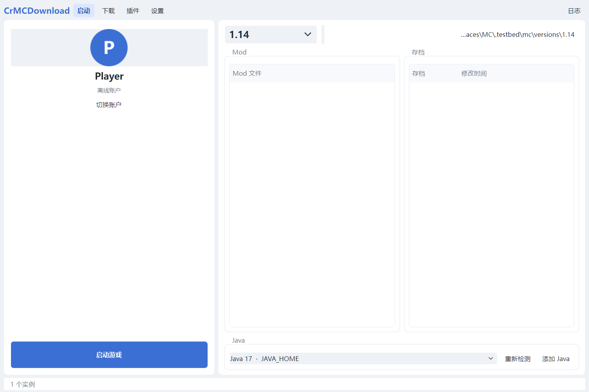

# CrMCDownload

自建镜像 + 离线账户的 Minecraft 启动器。客户端（PyQt6）从你的镜像服务器下载原版版本与资源并启动；服务端代理 Mojang / Fabric 官方文件并做磁盘缓存。

> 背景：2026 年 10 月起，PCL、HMCL 等第三方启动器陆续停止提供游戏下载。本项目把“下载源”做成可自建的镜像服务，客户端只与你的域名通信。



## 组成

```
┌──────────── 客户端 (user, PyQt6) ────────────┐      ┌──────── 服务端 (server) ────────┐
│ 启动 / 下载 / 插件 / 设置 · 离线包 · 日志      │ ───▶ │ 镜像代理 + 磁盘缓存 + 令牌        │ ───▶ Mojang
└───────────────────────────────────────────────┘ HTTPS └──────────────────────────────────┘
```

## 分支

| 分支 | 内容 |
| --- | --- |
| `main` | 文档（本分支） |
| `user` | 客户端集成：入口、配置、打包、集成测试 |
| `user-downloader` | 镜像重写、代理、下载器、元数据、安装、离线包 |
| `user-launcher` | 版本解析、rules、classpath、natives、Java、参数、进程 |
| `user-ui` | PyQt6 界面 |
| `server` | 服务端集成：`main.py` 入口、配置、测试 |
| `server-mirror` | 镜像核心：路由、缓存、Range、metrics |
| `server-deploy` | systemd / Docker / Caddy / nginx 部署物 |

每个分支在本地是一个独立 clone，目录名与分支名一致；合并方向 `user-* → user`、`server-* → server`。详见 [docs/BRANCHES.md](docs/BRANCHES.md)。

## 客户端

界面（PCL 风格，窗口宽高比 3:2，左右栏 2:3）：

- **启动**：左侧头像 / 用户名 / 启动游戏；右侧版本切换、版本目录、Mod 与存档列表、Java 选择（可添加本地 Java）
- **下载**：正式版 / 快照 / 远古版 / 已安装
- **插件**：市场 / 官方 / 社区 / 其他 / 已下载
- **F12**：修改下载源（默认 `https://mc.yjlt.top`）、令牌、代理与并发数

```bash
cd user
python main.py                     # 需要 PyQt6
# 或打包
pyinstaller CrMCDownload.spec --noconfirm --clean   # dist/CrMCDownload/CrMCDownload.exe
```

配置默认在 `%APPDATA%\CrMCDownload\config.json`。

## 服务端

```bash
cd server
uv sync --frozen
uv run --frozen main.py
curl http://127.0.0.1:8081/health
```

生产部署见 `server-deploy` 分支的 `DEPLOY.md`（systemd / Docker / nginx / Caddy）。

## 技术栈

- Python 3.12 + uv
- 客户端 GUI：PyQt6
- 服务端：标准库 `ThreadingHTTPServer`，可选 nginx/Caddy 反代
- 打包：PyInstaller（onedir 文件夹分发，免运行期解压）

## 文档

- [架构](docs/ARCHITECTURE.md)
- [分支与协作](docs/BRANCHES.md)
- [路线图](docs/ROADMAP.md)

## 许可证

MIT，见 [LICENSE](LICENSE)。
